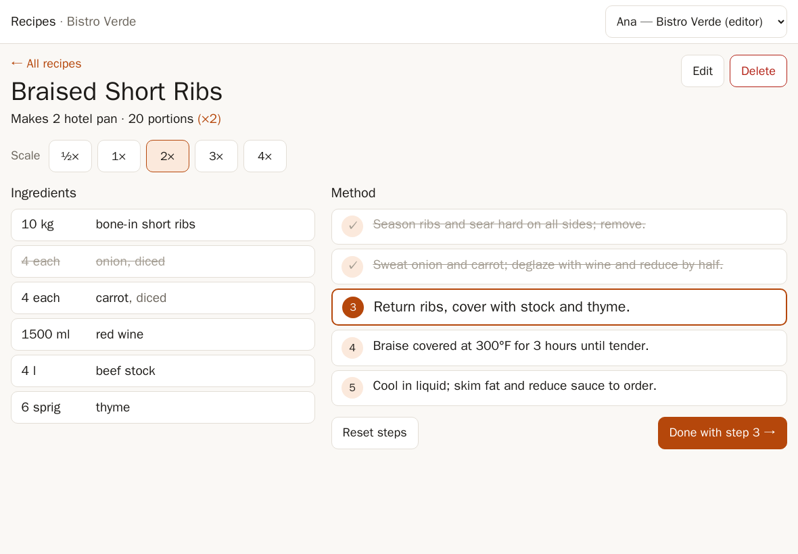
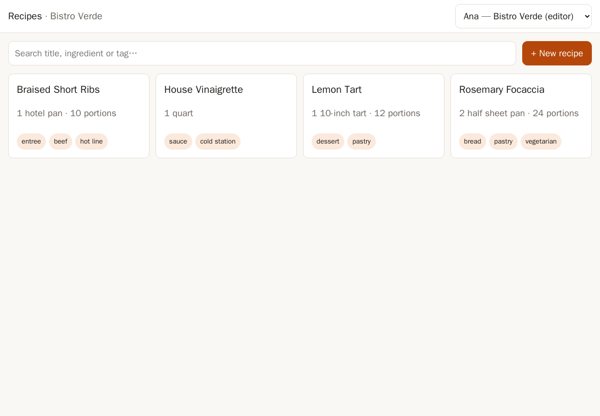
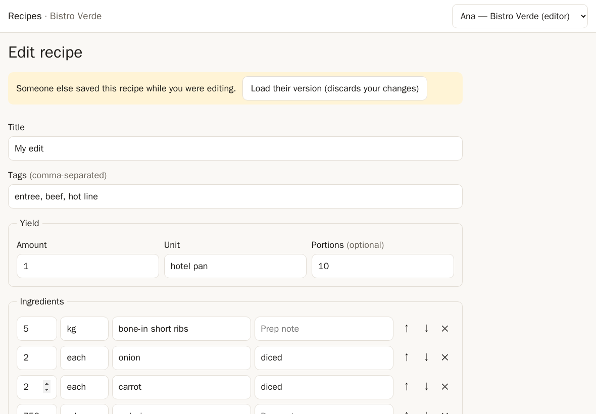
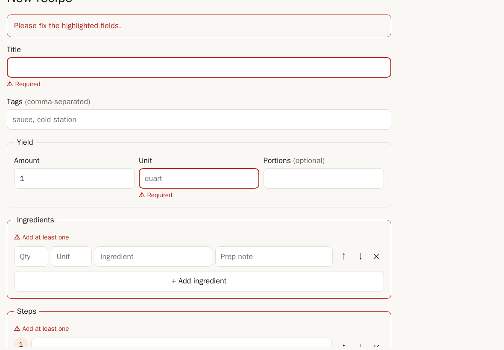
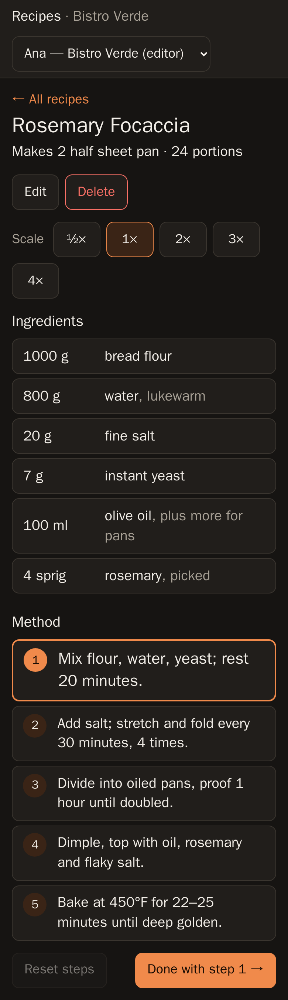

# Recipe Manager

A multi-restaurant recipe manager. Kitchens can search, view, scale, edit and
remove recipes, and each restaurant sees only its own recipes.

- **Backend:** Python 3.12, FastAPI, SQLAlchemy 2, SQLite (Postgres via config), pytest
- **Frontend:** React 18, Vite, TypeScript, with a tablet-friendly "cook mode"
- **Run:** `docker compose up`

The design and trade-offs are in [docs/ARCHITECTURE.md](docs/ARCHITECTURE.md).
The AI prompts I used are in [docs/PROMPTS.md](docs/PROMPTS.md).



## Quick start

You need Docker with Compose v2.

```bash
docker compose up --build
```

- App: http://localhost:8080
- API docs (Swagger): http://localhost:8000/docs

On first start the database is seeded with two competing restaurants. Switch
between users with the picker in the top right. Sign-in is stubbed.

| Token | User | Restaurant | Role |
|---|---|---|---|
| `bistro-editor` | Ana | Bistro Verde | editor |
| `bistro-viewer` | Ben | Bistro Verde | viewer |
| `harbor-editor` | Chloe | Harbor Grill | editor |
| `harbor-viewer` | Dev | Harbor Grill | viewer |

Both restaurants have a recipe called "House Vinaigrette", so you can check
that each one only sees its own.

Data is kept in the `recipe-data` Docker volume. To reset it, run
`docker compose down -v`.

### Try the API directly

```bash
curl -H "Authorization: Bearer bistro-viewer" "localhost:8000/api/recipes?q=rosemary"
curl -H "Authorization: Bearer bistro-viewer" "localhost:8000/api/recipes/2?scale=0.5"
curl -H "Authorization: Bearer harbor-viewer" -i localhost:8000/api/recipes/1   # 404: another restaurant's recipe
```

## Running without Docker

```bash
# Backend (terminal 1)
cd backend
python3.12 -m venv .venv && . .venv/bin/activate
pip install -r requirements-dev.txt
uvicorn --factory app.main:create_app --reload        # http://localhost:8000

# Frontend (terminal 2, Node 20+)
cd frontend
npm install
npm run dev                                           # http://localhost:5173, proxies /api to :8000
```

Configuration is read from environment variables (see `backend/app/config.py`):

| Variable | Default | Notes |
|---|---|---|
| `DATABASE_URL` | `sqlite:///./data/recipes.db` | e.g. `postgresql+psycopg://user:pw@host/db` (install `psycopg[binary]`) |
| `SEED_ON_STARTUP` | `true` | Only seeds a restaurant that has no recipes yet |

## Tests

```bash
cd backend && .venv/bin/pytest -q          # 100 tests: API, repository, schemas, scaling
cd frontend && npm test                    # 21 tests: quantity and yield formatting
```

The frontend Docker build runs `npm test` and the TypeScript check, so a
broken build won't start.

### Browser smoke test

With the stack running, this drives the real UI in headless Chromium. It
checks search, tag filter, scaling, the edit conflict, validation,
delete/undo, switching restaurants, and phone width with no horizontal
scroll. It also saves screenshots.

```bash
docker run --rm --network host -v "$PWD/e2e":/work -v "$PWD/docs/screenshots":/out -w /work \
  mcr.microsoft.com/playwright/python:v1.48.0-jammy \
  sh -c "pip install -q playwright==1.48.0 && python smoke_test.py"
```

## API summary

All routes are under `/api` and need `Authorization: Bearer <token>`.

| Method | Path | Role | Notes |
|---|---|---|---|
| GET | `/health` | none | liveness check |
| GET | `/me` | any | current user, restaurant, role |
| GET | `/recipes?q=&tag=&limit=20&offset=0` | any | search and paginate; returns `{items, total, limit, offset}` |
| POST | `/recipes` | editor | create; returns 201 |
| GET | `/recipes/{id}?scale=2` or `?target_yield=24` | any | recipe scaled on the server |
| PUT | `/recipes/{id}` | editor | full replace; body must include `version`, returns 409 if stale |
| DELETE | `/recipes/{id}` | editor | soft delete; returns 204 |
| POST | `/recipes/{id}/restore` | editor | undo a delete |

Every error comes back in one shape: `{"error": {"code", "message", ...}}`.
Status codes: 401 no or bad token, 403 viewer trying to write, 404 not found
(including another restaurant's recipe), 409 version conflict, 422 invalid
input.

## Screenshots

| Recipe list | Edit conflict (409) |
|---|---|
|  |  |

| Validation errors | Phone, dark mode |
|---|---|
|  |  |

## Project layout

```
backend/
  app/
    main.py          app factory, routes for /health and /me
    config.py        settings from env
    db.py            engine, session dependency
    models.py        Recipe table
    schemas.py       request/response models and validation
    auth.py          stub tokens -> user (org, role)
    repository.py    tenant-scoped data access (search, versioning, soft delete)
    scaling.py       pure yield-scaling functions
    errors.py        error types and the single JSON error shape
    routers/recipes.py
    seed.py
  tests/
frontend/src/
  api.ts             typed API client
  auth.tsx           stub "sign in as" picker
  lib/format.ts      quantity formatting (1.5 cup -> "1 ½ cup", 7.5 g stays decimal)
  pages/             RecipeList, RecipeView (cook mode), RecipeEdit
e2e/smoke_test.py    headless browser check
docs/                architecture, prompts, screenshots
```
